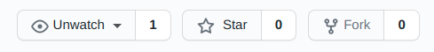
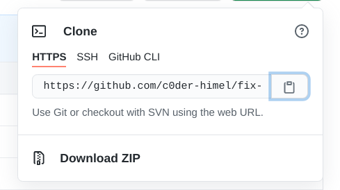
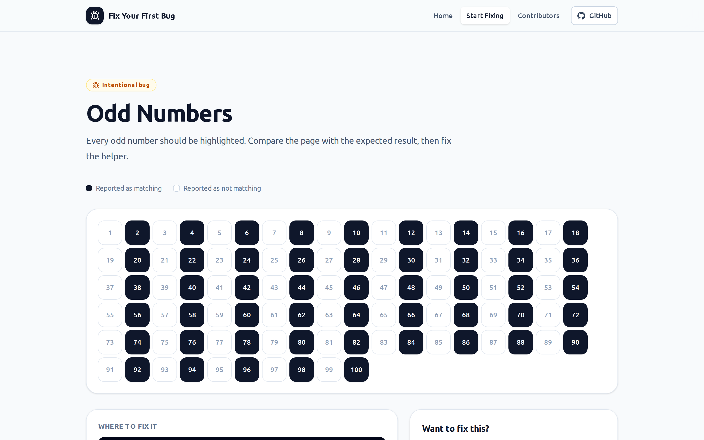
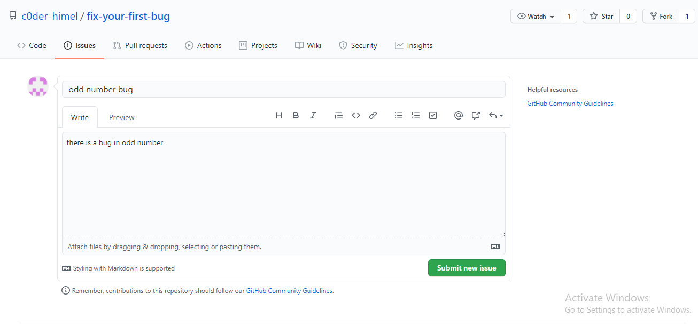
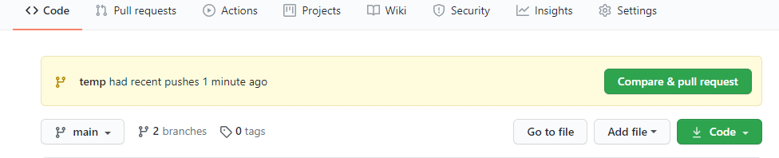
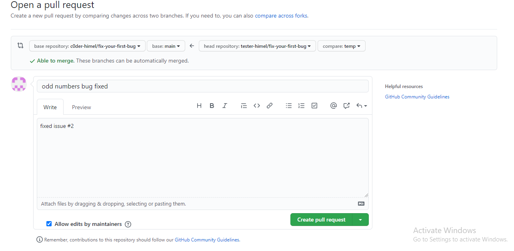

# Contributing to Fix Your First Bug

Thanks for being here. This project exists so that your first open-source contribution can be a real one — a fork, a branch, a review, and a merge — without the pressure of a huge codebase.

The whole app has three bugs. Fix one of them, or improve the project itself. Every pull request gets a Vercel preview deployment, and the CI workflow runs lint, type checks, a production build, and the Playwright suite.

The maintained deployment is live at [fix-your-first-bug.vercel.app](https://fix-your-first-bug.vercel.app/). You can explore the finished app there before setting up a local copy.

## Before you start

- **Node.js 20.9 or newer** (CI uses Node 22; see `.nvmrc`).
- A GitHub account and Git installed locally.
- No prior open-source experience required.

If you get stuck at any step, open an issue or leave a comment on the issue you are working on. Asking questions is part of contributing.

## Step 1 — Fork the repository



Open [github.com/dev-himel-0o0/fix-your-first-bug](https://github.com/dev-himel-0o0/fix-your-first-bug) and click **Fork** in the top-right corner. This creates your own copy of the repository under your account.

<br clear="right" />

## Step 2 — Clone your fork


On your fork, click **Code**, then copy the HTTPS URL.



```sh
git clone https://github.com/<your-username>/fix-your-first-bug.git
cd fix-your-first-bug
```

<br clear="right" />

## Step 3 — Keep your fork up to date

Add the original repository as `upstream` so you can pull future changes:

```sh
git remote add upstream https://github.com/dev-himel-0o0/fix-your-first-bug.git
git pull upstream main
```

## Step 4 — Create a branch

Never work directly on `main`. Create a branch with a short, descriptive name:

```sh
git checkout -b fix-odd-numbers
```

Other examples: `fix-even-numbers`, `fix-prime-numbers`, `docs/update-readme`.

## Step 5 — Run the app and find the bug

```sh
npm install
npm run dev
```

Open [http://localhost:3000](http://localhost:3000), click **Start fixing**, and pick an exercise. Compare the highlighted numbers with the title of the page:



- **Odd Numbers** highlights even numbers.
- **Even Numbers** highlights odd numbers.
- **Prime Numbers** highlights `0` and `1`.

The bug files are in:

```text
src/lib/bugs/numberTheory/oddNumbers.ts
src/lib/bugs/numberTheory/evenNumbers.ts
src/lib/bugs/numberTheory/primeNumbers.ts
```

Each file exports a single function. Change the condition that is wrong and reload the page — the grid should update immediately. **Keep the `(x: number) => boolean` signature intact.** Do not edit the pages, the grid component, or the tests to make a bug pass.

<br clear="right" />

## Step 6 — Open an issue



Before (or right after) you start fixing, open an issue describing what you found. Use the provided issue template. This gives maintainers context and lets others know the bug is being worked on.

Link your pull request to the issue with `Closes #<issue-number>` in the PR description so it closes automatically when merged.

<br clear="right" />

## Step 7 — Verify your change

Run the same checks CI runs:

```sh
npm run lint
npm run typecheck
npm run build
npx playwright install chromium   # first time only
npm run test:e2e
```

All four must pass. The E2E tests also confirm that every route renders and that the number grids contain the expected cells.

## Step 8 — Commit and push

```sh
git add src/lib/bugs/numberTheory/oddNumbers.ts
git commit -m "fix: report odd numbers as odd"
git push origin fix-odd-numbers
```

Use a clear commit message. `fix:`, `docs:`, `test:`, `chore:`, and `feat:` prefixes are welcome but not mandatory.

## Step 9 — Open a pull request



Go to your fork on GitHub. You will see a **Compare & pull request** button for your branch. Click it.



Fill in the PR template:

- What bug did you fix?
- Which file did you change?
- How did you verify the fix?

Submit the pull request against `main`. Vercel will post a preview URL as a comment, and CI will report its checks. A maintainer will review your work. Once it is merged, your GitHub profile shows the contribution.

<br clear="right" />

## Pull request guidelines

- One bug or one small change per pull request.
- Do not reformat unrelated code or bump dependencies unless the PR is about that.
- Do not change the tests to make a broken function pass.
- Keep the TypeScript types and the existing function signatures.
- If you change UI, include a screenshot in the PR description.
- Be patient and kind during review. This is a learning project.

## Reporting a problem

Open an issue using the bug report template. Include your OS, Node version, the command you ran, and the full error output.

## Code of conduct

By participating, you agree to follow the [Code of Conduct](CODE_OF_CONDUCT.md). Harassment or dismissive behaviour toward beginners will not be tolerated.

## License

By contributing, you agree that your contributions are licensed under the [MIT License](LICENSE).
