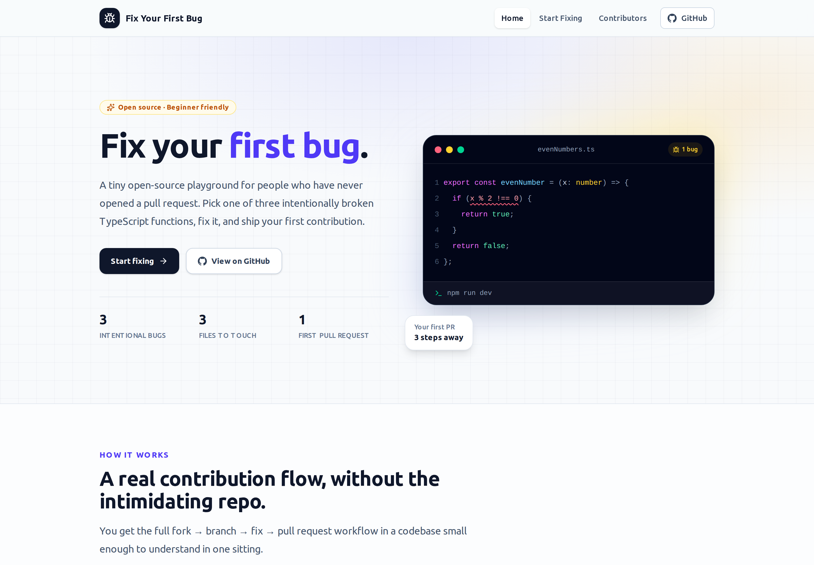
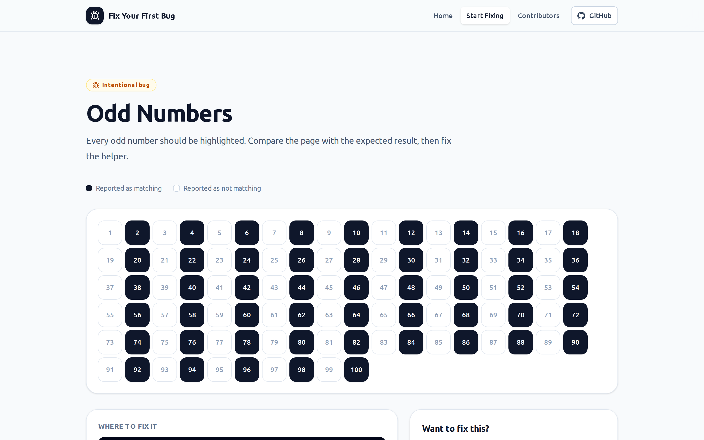

# Fix Your First Bug

> A tiny open-source playground for people who have never opened a pull request.

[](https://github.com/dev-himel-0o0/fix-your-first-bug/actions/workflows/ci.yml)
[](LICENSE)
[](https://nextjs.org)
[](https://www.typescriptlang.org)
[](https://tailwindcss.com)

**Fix Your First Bug** is a deliberately small Next.js app with three intentionally broken TypeScript functions. Pick one, fix it, and walk through the real contribution flow — fork, branch, commit, pull request — on a codebase small enough to understand in one sitting.



## Why this exists

Most "good first issue" labels live in repositories with thousands of files. That is a lot of pressure for a first pull request. This project keeps the whole workflow but shrinks the codebase down to three functions that each contain one obvious bug. You cannot break anything outside the file you are fixing.

## The bugs

| Exercise | File | What is wrong |
| --- | --- | --- |
| Odd Numbers | `src/lib/bugs/numberTheory/oddNumbers.ts` | Even numbers are highlighted instead of odd numbers |
| Even Numbers | `src/lib/bugs/numberTheory/evenNumbers.ts` | Odd numbers are highlighted instead of even numbers |
| Prime Numbers | `src/lib/bugs/numberTheory/primeNumbers.ts` | `0` and `1` are reported as prime |

Each exercise page renders a grid of numbers (`1–100` for odd/even, `0–100` for prime). The highlighted cells come straight from the buggy function, so the page itself tells you whether your fix worked.



> [!IMPORTANT]
> Fix only the exported function. Keep the `(x: number) => boolean` signature intact so the page keeps rendering after your change.

## Quick start

Requirements: **Node.js 20.9+** (see `.nvmrc`, Node 22 is used in CI) and npm.

```sh
git clone https://github.com/dev-himel-0o0/fix-your-first-bug.git
cd fix-your-first-bug
npm install
npm run dev
```

Open [http://localhost:3000](http://localhost:3000).

### Scripts

| Command | What it does |
| --- | --- |
| `npm run dev` | Start the development server |
| `npm run build` | Create a production build |
| `npm run start` | Serve the production build |
| `npm run lint` | Run ESLint |
| `npm run typecheck` | Run `tsc --noEmit` |
| `npm run test:e2e` | Run the Playwright suite (starts the app automatically) |
| `npm run test:e2e:ui` | Run Playwright in UI mode |

The first time you run the E2E suite, install the browser:

```sh
npx playwright install chromium
```

## Project structure

```text
src/
├── app/                         # App Router pages, metadata, sitemap, manifest
│   ├── odd-numbers/
│   ├── even-numbers/
│   ├── prime-numbers/
│   ├── select/
│   └── contributors/
├── components/                  # Navbar, footer, bug cards, number grid
├── lib/
│   ├── bugs/numberTheory/       # ← the three intentional bugs live here
│   ├── github.ts                # server-side contributors fetch
│   └── site.ts                  # repo/URL configuration
└── types/
tests/e2e/                       # Playwright tests for every route
```

## Tech stack

- [Next.js 16](https://nextjs.org) (App Router, Server Components, Turbopack)
- [React 19](https://react.dev)
- [TypeScript](https://www.typescriptlang.org) in strict mode
- [Tailwind CSS 4](https://tailwindcss.com)
- [lucide-react](https://lucide.dev) icons
- [Playwright](https://playwright.dev) end-to-end tests
- Deployed on [Vercel](https://vercel.com)

## Contributing

Read [CONTRIBUTING.md](CONTRIBUTING.md) for the full fork → branch → fix → pull-request walkthrough. The short version:

1. Fork this repository and clone your fork.
2. Create a branch: `git checkout -b fix-odd-numbers`.
3. Fix one function in `src/lib/bugs/numberTheory/`.
4. Run `npm run lint && npm run typecheck && npm run test:e2e`.
5. Commit, push to your fork, and open a pull request against `main`.

Every pull request gets a Vercel preview deployment. Please keep PRs focused on a single bug, and be kind in reviews — everyone here is learning.

This project follows the [Contributor Covenant](CODE_OF_CONDUCT.md).

## Configuration

Copy `.env.example` to `.env.local` for local overrides. All variables are optional in development.

| Variable | Default | Purpose |
| --- | --- | --- |
| `NEXT_PUBLIC_GITHUB_REPO` | `dev-himel-0o0/fix-your-first-bug` | Repo slug used for GitHub links and the contributors page |
| `NEXT_PUBLIC_SITE_URL` | `http://localhost:3000` (or the Vercel URL) | Canonical URL for metadata, `robots.txt`, and `sitemap.xml` |
| `GITHUB_TOKEN` | unset | Optional server-only token that raises the GitHub API rate limit |

> `GITHUB_TOKEN` is read on the server only. Do not prefix it with `NEXT_PUBLIC_`.

## Deployment

The app deploys to Vercel with zero extra configuration:

1. Import the repository at [vercel.com/new](https://vercel.com/new).
2. Set `NEXT_PUBLIC_GITHUB_REPO` and `NEXT_PUBLIC_SITE_URL` in Project Settings → Environment Variables.
3. Optionally add `GITHUB_TOKEN` to raise the contributors API rate limit.
4. Deploy. Vercel will also create a preview deployment for every pull request.

## Changelog

See [CHANGELOG.md](CHANGELOG.md). Version 2.0.0 is the Next.js rewrite of the original Create React App project.

## Credits

Originally created by [MD. Shahadat Hussain Himel](https://github.com/dev-himel-0o0) in 2021 as a demo repository for first-time contributors. The project is inspired by [Pledge](https://github.com/codeforcauseorg/pledge) by Code for Cause.

## License

[MIT](LICENSE) © 2021–2026 MD. Shahadat Hussain Himel
